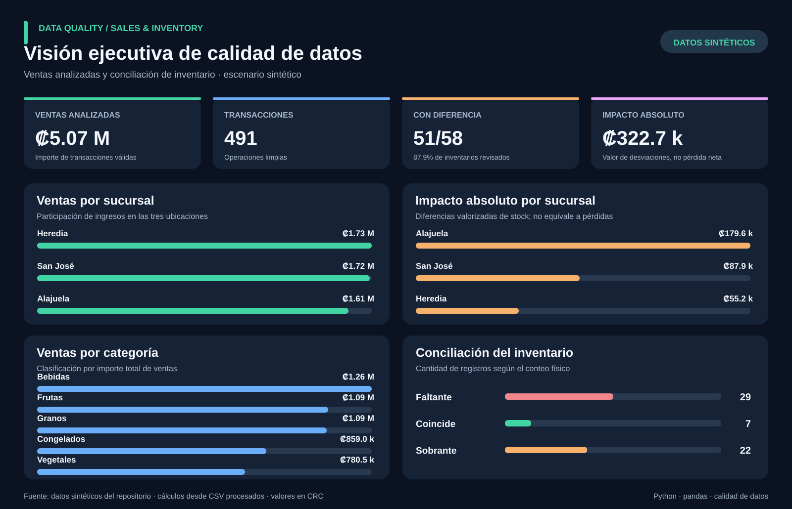
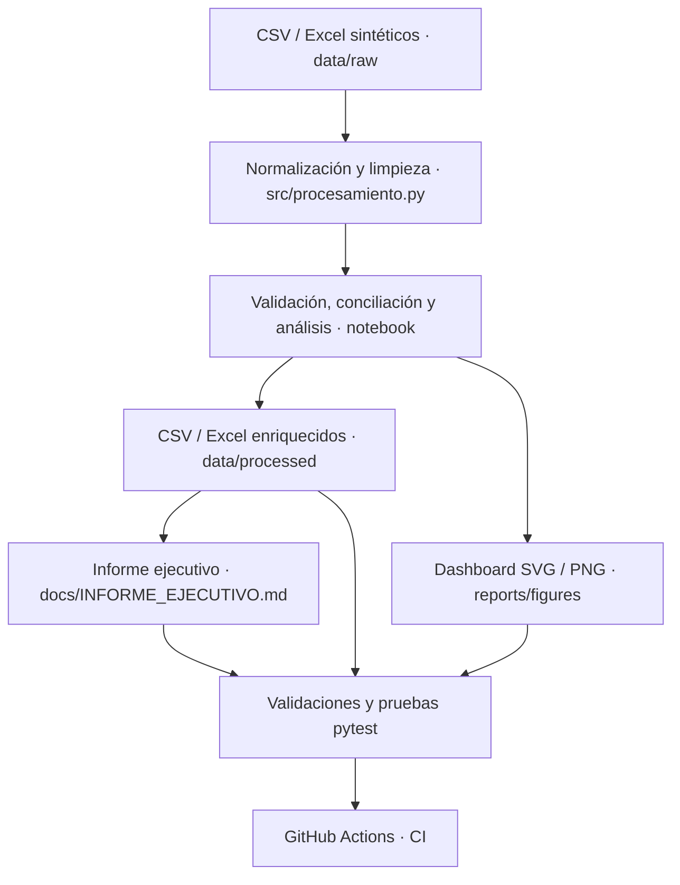

# Data Quality | Sales & Inventory Analytics

[](https://github.com/HenryGonzalezAlguera/data-quality-sales-inventory/actions/workflows/python-data-quality.yml)


**Proyecto de análisis de datos: limpieza, validación, conciliación de inventario y recomendaciones de negocio.** Integra fuentes CSV y Excel sintéticas mediante Python/pandas, automatiza pruebas de calidad y genera un dashboard ejecutivo y reportes reproducibles.

> **English summary:** A reproducible data analytics portfolio case that cleans synthetic sales and inventory data, applies data-quality rules, reconciles physical vs. system stock, and communicates prioritized business findings. Built with Python, pandas, Jupyter, Excel, pytest and GitHub Actions. **Synthetic data only; no production system or live company data.**

## Dashboard ejecutivo



[Ver dashboard en SVG](reports/figures/dashboard_ejecutivo.svg) · [Ver análisis exploratorio en PNG](reports/figures/dashboard_ventas_inventario.png) · [Leer informe ejecutivo completo](docs/INFORME_EJECUTIVO.md)

## Resultados destacados

<details>
<summary>¿Qué datos se analizaron?</summary>

Tres fuentes sintéticas: `data/raw/catalogo_productos.csv`, `data/raw/ventas.csv` y `data/raw/inventario.xlsx`. El período de las ventas procesadas comprende del **1 de enero al 30 de junio de 2026**. Los archivos contienen errores intencionales con fines de aprendizaje.

</details>

| Indicador verificado | Resultado |
| --- | ---: |
| Transacciones válidas | **491** |
| Unidades vendidas | **3,578** |
| Importe total de ventas analizadas | **₡5,073,392.98** |
| Productos de catálogo procesados | **20** |
| Registros de inventario con diferencias | **51 de 58 (87.93%)** |
| Diferencias absolutas de inventario | **230 unidades** |
| Valor absoluto de discrepancias | **₡322,700.00** |
| Valor neto de discrepancias | **₡87,900.00** |

**Importante:** el valor absoluto mide la suma de desajustes valorizados sin compensar faltantes con sobrantes; **no representa una pérdida contable comprobada**. Los importes de ventas tampoco equivalen necesariamente a dinero cobrado ni a rentabilidad.

## El hallazgo que prioriza la acción

**Alajuela concentra ₡179,600 (55.66%)** del impacto absoluto de inventario. La discrepancia individual más relevante es **P013 — Lentejas**, con **80 unidades de sobrante** (193 registradas frente a 273 físicas), valorizadas en **₡116,000**. Por ello, el primer paso propuesto es verificar el conteo y reconstruir sus movimientos, antes de sacar conclusiones sobre causas.

| Sucursal | Importe de ventas | Impacto absoluto de inventario |
| --- | ---: | ---: |
| Heredia | ₡1,734,179.99 | ₡55,200.00 |
| San José | ₡1,724,364.79 | ₡87,900.00 |
| Alajuela | ₡1,614,848.20 | ₡179,600.00 |

**Lectura de negocio:** la sucursal con mayores ventas no es necesariamente la que presenta más discrepancias. Conviene priorizar una revisión operativa de Alajuela y fortalecer reglas de captura y conteos cíclicos en todas las sucursales.

[Hallazgos, metodología y acciones detalladas](docs/INFORME_EJECUTIVO.md)

## ¿Qué demuestra técnicamente?

| Competencia | Evidencia comprobable |
| --- | --- |
| Data cleaning / ETL | [Pipeline reutilizable de pandas](src/procesamiento.py): normalización, deduplicación, validación y tratamiento de registros |
| Data quality | [Validador](src/validar_entregables.py): integridad referencial, cantidades, fechas, importes y stock |
| Business analysis | [Informe ejecutivo](docs/INFORME_EJECUTIVO.md) con hallazgos y plan de acción |
| Data visualization | [Dashboard vectorial](src/dashboard_ejecutivo.py) reproducible desde CSV |
| Data storytelling | [Notebook Jupyter](notebooks/01_auditoria_calidad_datos.ipynb) y reporte Excel |
| Testing / CI | [Pruebas pytest](tests/) y [GitHub Actions](.github/workflows/python-data-quality.yml) |
| Reproducibilidad | [Generación sintética](src/generar_datos.py), pipeline de notebook y verificación de entregables |

### Flujo de datos



El **notebook** coordina la lectura, la exploración, el análisis y las exportaciones. Las principales reglas de limpieza están separadas en funciones importables que no alteran los DataFrames originales.

## Ejecutar en Windows (PowerShell)

**Requisitos:** Python 3.13 y Git. El proyecto usa paquetes de `requirements-dev.txt` (incluye `requirements.txt`).

```powershell
git clone https://github.com/HenryGonzalezAlguera/data-quality-sales-inventory.git
cd data-quality-sales-inventory

py -3.13 -m venv .venv
.\.venv\Scripts\python.exe -m pip install -r requirements-dev.txt

# Los siguientes comandos verifican archivos existentes; no alteran las fuentes:
.\.venv\Scripts\python.exe -m src.validar_entregables
.\.venv\Scripts\python.exe -m src.informe_ejecutivo --verificar
.\.venv\Scripts\python.exe -m pytest -q tests
```

Para **regenerar solo el SVG** desde las tablas procesadas (modifica ese archivo de salida, no las fuentes):

```powershell
.\.venv\Scripts\python.exe -m src.dashboard_ejecutivo
```

Para ejecutar el análisis completo abre `notebooks/01_auditoria_calidad_datos.ipynb` en Jupyter o VS Code con el entorno virtual y ejecuta sus celdas. **Esto puede sobrescribir archivos de `data/processed` y `reports`.** Para regenerar las fuentes sintéticas, `python src/generar_datos.py` **sobrescribe `data/raw`**: realiza una copia de seguridad si hiciste modificaciones.

[Guía de reproducción paso a paso](docs/GUIA_DEMO.md)

## Proyecto organizado por responsabilidades

```text
data-quality-sales-inventory/
├── data/
│   ├── raw/                    # 3 fuentes sintéticas
│   └── processed/              # CSV y Excel depurados
├── src/
│   ├── generar_datos.py        # fuentes de demostración
│   ├── procesamiento.py        # reglas reutilizables
│   ├── validar_entregables.py  # integridad y KPI
│   ├── dashboard_ejecutivo.py  # visualización SVG
│   └── informe_ejecutivo.py    # hallazgos en Markdown
├── notebooks/
│   └── 01_auditoria_calidad_datos.ipynb
├── reports/
│   ├── figures/                # SVG ejecutivo y PNG exploratorio
│   └── reporte_analisis.xlsx
├── docs/                       # informe, metodología, demo y publicación
├── tests/                      # pruebas de calidad, pipeline y salidas
├── .github/workflows/          # Python Data Quality CI
├── requirements.txt
└── requirements-dev.txt
```

## Validaciones automáticas

Cada cambio o pull request ejecuta en GitHub Actions la generación sintética, el notebook completo y las comprobaciones de resultados. CI valida que el SVG publicado sea reproducible, que el informe corresponda a los CSV regenerados y que pasen las pruebas de `pytest`. **No requiere servicios externos ni credenciales.**

[Ver historial de GitHub Actions](https://github.com/HenryGonzalezAlguera/data-quality-sales-inventory/actions/workflows/python-data-quality.yml) · [Ver pruebas](tests/)

## Documentación y presentación

- [Informe ejecutivo con recomendaciones](docs/INFORME_EJECUTIVO.md)
- [Guía de demo y reproducción](docs/GUIA_DEMO.md)
- [Publicación LinkedIn en español e inglés](docs/PUBLICACION_LINKEDIN.md)
- [Calidad y CI](docs/FASE1_CALIDAD_Y_CI.md)
- [Pipeline modular](docs/FASE2_PIPELINE_MODULAR.md)
- [Dashboard ejecutivo](docs/FASE3_DASHBOARD.md)

## Alcance y limitaciones

Los datos son **sintéticos** y contienen errores intencionales. El trabajo es un caso de estudio reproducible, **no** un análisis de una empresa real, un sistema de inventario en tiempo real, un servicio alojado ni un dashboard interactivo. No incluye pagos, costos completos, causalidad de diferencias ni proyecciones estadísticamente validadas. Los archivos de Excel pueden abrirse en herramientas como Power Query, pero el repositorio **no incluye una consulta `M`, un archivo Power BI ni un dashboard Power Query publicado**.

---

**Proyecto de portafolio de Henry González Alguera** · Python · Data Analytics · Data Quality · Costa Rica.
