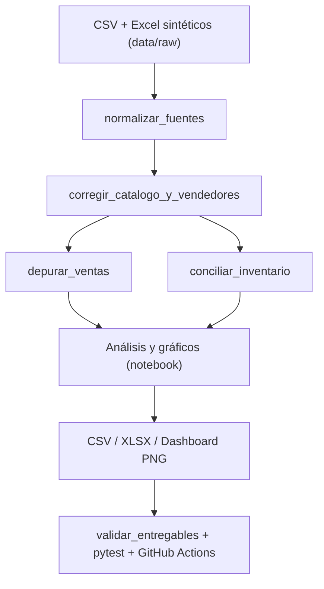

# Fase 2 — Pipeline de calidad modular y reutilizable

## Problema resuelto

La primera versión implementaba la limpieza de fuentes directamente en el
notebook `notebooks/01_auditoria_calidad_datos.ipynb`. Ahora las cuatro
transformaciones de limpieza se implementan **una sola vez** en
`src/procesamiento.py` y el notebook las importa.



## Funciones públicas

| Función | Entradas | Salidas |
| --- | --- | --- |
| `normalizar_fuentes` | Catálogo, ventas, inventario | Las tres fuentes sin duplicados exactos, textos normalizados y resumen |
| `corregir_catalogo_y_vendedores` | Catálogo y ventas normalizados | Precios del catálogo reparados, textos faltantes completados y resumen |
| `depurar_ventas` | Ventas y catálogo corregido | Ventas válidas, tipos/fechas/importe normalizados y dos tablas de diagnóstico |
| `conciliar_inventario` | Inventario y catálogo corregido | Stock conciliado, clasificación faltante/sobrante y diagnósticos |

**Contrato:** todas reciben `pandas.DataFrame`, devuelven nuevos DataFrames y
**no modifican los originales**. No realizan IO ni escriben rutas,
por lo que se pueden importar desde Jupyter, pruebas, scripts o una futura API.

## Ejemplo de uso

```python
import pandas as pd
from src.procesamiento import (
    normalizar_fuentes, corregir_catalogo_y_vendedores,
    depurar_ventas, conciliar_inventario,
)

catalogo = pd.read_csv("data/raw/catalogo_productos.csv", encoding="utf-8-sig")
ventas = pd.read_csv("data/raw/ventas.csv", encoding="utf-8-sig")
inventario = pd.read_excel("data/raw/inventario.xlsx", sheet_name="Inventario")

catalogo, ventas, inventario, normalizacion = normalizar_fuentes(
    catalogo, ventas, inventario
)
catalogo, ventas, correcciones = corregir_catalogo_y_vendedores(catalogo, ventas)
ventas, errores_ventas, limpieza_ventas = depurar_ventas(ventas, catalogo)
inventario, errores_inventario, limpieza_inventario = (
    conciliar_inventario(inventario, catalogo)
)
```

Estas funciones reproducen **las reglas originales del notebook**, no pretenden
ser un producto ETL genérico para cualquier esquema o tipo de entrada. Por
ejemplo, la sustitución de precios inválidos usa la mediana de la categoría y
las ventas inválidas se descartan según las reglas del ejercicio.

## Pruebas

La fase incorpora `tests/test_pipeline_modular.py`, que compara las tres
salidas limpias con los CSV históricos, verifica cálculos contra los KPI
sintéticos y comprueba que las entradas no se alteran.

```powershell
.\.venv\Scripts\python.exe -m pytest -q tests
.\.venv\Scripts\python.exe -m src.validar_entregables
```

GitHub Actions **ejecuta el notebook modificado de principio a fin** antes de
los validadores. Una discrepancia en ventas, inventario, Excel o dashboard hace
fallar el pipeline, sin necesidad de datos comerciales reales.

## Alcance pendiente

En esta etapa se extrae la **limpieza y conciliación**. La generación de datos,
la auditoría exploratoria, los indicadores comerciales, los gráficos y las
exportaciones siguen en sus archivos originales; se modularizarán solo cuando
haya pruebas equivalentes que preserven sus resultados.
